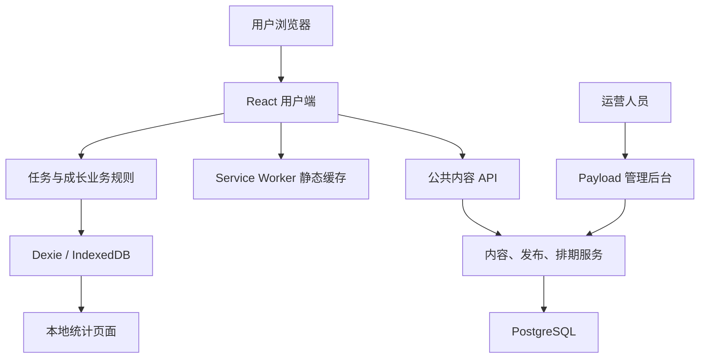

# 人生支线技术架构与模块拆分

| 项目 | 内容 |
|---|---|
| 文档版本 | V0.5 |
| 编制日期 | 2026-09-15 |
| 状态 | 主要用户闭环、内容运营基础和本地统计已实现；远端统计移出首版，生产验收尚未完成，见主要功能操作说明 |
| 需求依据 | [人生支线产品需求分析文档 V1.3](./1.人生支线产品需求分析文档.md) |
| 适用范围 | 响应式 Web / PWA MVP，按 1–3 人开发设计 |

## 一、架构目标与范围

首版采用“本地优先的用户端 + 集中管理的公共内容服务”。个人任务、经历、成长与统计数据均保存于当前浏览器；服务端仅负责公共任务、今日排期和运营账号，不接收用户统计事件。

PWA 是具备桌面入口和离线增强能力的网站，不需要开发原生安装包。安装入口和离线能力取决于浏览器支持，核心在线流程应可作为普通网站使用。

### 1.1 首版交付

- 用户端：匿名使用、任务浏览与随机、收藏接取、完成与放弃、人生存档、六维角色卡、今日支线。
- 内容端：任务编辑、审核、版本发布、上下架、批量导入导出、每日排期、管理员权限与审计；统计概览仅在用户端本地提供。
- 基础能力：本地持久化、离线读取和文字记录、照片本地保存、个人数据导出删除、测试与部署。

### 1.2 数据边界

| 数据类型 | 权威存储位置 | 边界 |
|---|---|---|
| 公开任务、任务版本、下架状态、每日排期 | PostgreSQL | 浏览器持有公开内容缓存 |
| 匿名身份、接取状态、个人文字照片、经验和属性流水 | IndexedDB | 首版仅限当前浏览器与站点，不承诺云备份或跨设备恢复 |
| 运营账号、角色、审核记录 | PostgreSQL | 仅授权人员可访问 |
| 本地行为事件与汇总 | IndexedDB | 仅当前浏览器统计，不上报；随个人数据导出和删除 |

匿名标识是本地记录和统计去重标识，不是登录凭证。本地奖励可被用户修改或随清除数据重置，首版不能提供跨设备防重复领奖保证，也不将其用于排名、交易或权益兑换。

账号、云同步、云图片存储、公开分享、AI 推荐和社交功能列入后续阶段。增加云同步前需另行设计身份绑定、记录合并和奖励校验。

## 二、技术框架与选型

已确认后端采用 Payload CMS，使用 TypeScript，在 Node.js / Next.js 上运行，同时承载运营后台和 API。基础内容接口使用 Payload 能力，发布和排期通过自定义接口与服务实现；首版统计仅在客户端实现。

其余技术栈按下表作为开发基线，不表示仓库已经配置。初始化时选择相互兼容的稳定版本，固定 Node.js 与包管理器版本并提交锁文件；不直接混用各组件的最新版本。

| 层级 | 技术 | 使用范围与理由 |
|---|---|---|
| 用户端 | React、TypeScript、Vite | 构建以交互和本地数据为核心的客户端应用 |
| 页面路由 | React Router | 首页、任务详情、我的支线、存档、角色卡、设置 |
| 样式 | Tailwind CSS | 维护统一颜色、间距、字体、移动端布局 |
| 字段校验 | Zod | 共享任务字段、接口响应、导入文件及事件格式校验 |
| 本地数据库 | IndexedDB、Dexie、dexie-react-hooks | 保存结构化记录和照片；事务写入；数据变更驱动界面更新 |
| PWA | vite-plugin-pwa、Workbox | 应用清单、静态资源缓存、版本更新提示 |
| 内容后台与服务 | Payload CMS、Next.js、Node.js | 使用 Payload 后台及权限体系，定制发布、排期和统计接口 |
| 服务端数据库 | PostgreSQL、Payload PostgreSQL adapter | 内容、运营数据、唯一约束和事务；迁移由内容工程统一管理 |
| 单元及集成测试 | Vitest、fake-indexeddb | 规则测试、本地事务和迁移测试；关键行为补真实浏览器验证 |
| 端到端测试 | Playwright | 用户闭环、离线、多标签页和后台权限流程 |
| 工程管理 | pnpm workspace、ESLint、Prettier | 管理两个应用与共享包，统一代码质量检查 |
| 部署 | 静态托管 + Node.js 服务 + PostgreSQL | 首版保持少量部署单元；内容服务可使用容器部署 |

Payload 提供后台和数据库接入基础，但任务预览、业务版本快照、审核流、排期冲突、导入错误报告和统计页面仍需开发。用户端采用 Vite，内容端因 Payload 使用 Next.js，两者独立构建。首版不额外引入全局状态库：业务持久化状态来自 Dexie，临时界面状态使用 React。

## 三、系统架构



### 3.1 客户端分层

1. 页面层：展示状态、收集输入、提供加载和错误反馈。
2. 应用服务层：编排接取、完成、放弃、导出等操作。
3. 领域层：纯函数实现状态转换、奖励计算、随机排除和日期规则。
4. 数据层：封装 IndexedDB、公共 API 和本地统计事件。

页面不直接修改奖励流水。领域层不依赖 React、Dexie 或 Payload，通过参数传入时间、随机数和规则配置，便于测试和以后复用。

### 3.2 服务端分层

- Payload Collections：维护内容字段、账号角色和基础读写权限。
- 业务服务：统一执行审核发布、生成不可变任务版本、下架和每日替换。
- 公共 API：只输出经过筛选的公开字段，不暴露作者账号、审核意见或草稿。
- 首版无服务端用户统计；本地事件去重及按日期、任务聚合在浏览器中完成。

后台页面和直接接口请求使用相同权限规则；服务内部调用也必须明确执行授权检查，不能依赖界面隐藏按钮。

## 四、工程目录与开发约定

```text
apps/
  web/
    src/
      app/                 路由、布局、初始化
      features/            按任务、存档、角色卡等功能组织
      components/          通用界面组件
      services/            用户操作编排
      data/                本地表、迁移、公开内容获取、事件队列
    public/                图标、应用清单所需资源
  content/
    src/
      collections/         任务、版本、排期、管理员、事件
      services/            发布、排期、统计业务
      endpoints/           定制 API
      migrations/          数据库迁移
packages/
  domain/                  状态机、奖励和随机规则
  contracts/               枚举、Zod schemas、接口类型
tests/
  e2e/                     跨模块浏览器验收
docs/                      需求、技术方案、决策与验证记录
```

单元测试就近命名为 `*.test.ts`，浏览器测试命名为 `*.spec.ts`。TypeScript 启用严格检查，采用两空格缩进，由格式化工具统一处理。React 组件使用 PascalCase，函数和变量使用 camelCase，持久化字段和接口字段在 contracts 中统一，不临时混用命名。

拟在初始化任务中实现以下根目录命令；当前仓库尚不可执行：

| 命令 | 预期作用 |
|---|---|
| `pnpm install` | 安装工作区依赖 |
| `pnpm dev` | 启动用户端与内容端；本地数据库需提前就绪 |
| `pnpm build` | 构建应用和共享包 |
| `pnpm lint` / `pnpm typecheck` | 静态检查与类型检查 |
| `pnpm test` | 单元和集成测试 |
| `pnpm test:e2e` | Playwright 核心流程测试 |
| `pnpm db:migrate` | 显式执行内容端数据库迁移 |

## 五、核心数据模型

### 5.1 服务端实体

| 实体 | 关键字段/约束 | 说明 |
|---|---|---|
| Quest | id、status、currentVersionId | 任务稳定身份与当前发布状态 |
| QuestDraft | questId、内容、reviewStatus、reviewer | 可修改的编辑内容；可通过 CMS 草稿机制实现 |
| QuestVersion | id、questId、versionNo、snapshot、publishedAt | 唯一 `(questId, versionNo)`；发布后不可修改 |
| DailyQuest | id、date、timezone、questVersionId、revision | 唯一 `(date, timezone)`；替换保留当日身份并增加修订号 |
| AdminUser | id、role、账号认证字段 | 管理员和内容编辑 |
| AuditLog | actorId、action、entityId、changeSummary、createdAt | 记录发布、下架、排期和权限变更 |

任务内容包含需求中的类别、执行步骤、时间预算、同行方式、环境限制、安全标签、经验、六维奖励和重复策略。contracts 是枚举与校验规则的共享入口。

### 5.2 本地实体

| 实体 | 关键字段/约束 | 说明 |
|---|---|---|
| LocalProfile | id、createdAt、schemaVersion | 随机匿名身份及本地元信息 |
| CatalogCache | revision、fetchedAt、expiresAt、tasks、withdrawals | 公开任务缓存和下架信息 |
| DailyCache | dailyId、date、timezone、revision、snapshot、serverTime | 已获取的每日排期 |
| Favorite | questId、createdAt | 独立收藏关系，不发奖 |
| UserQuest | id、questId、questVersionId、snapshot、source、dailyId、status、acceptedAt | 每次重新接取生成新的执行记录 |
| Completion | id、userQuestId、note、photoId、city、completedAt | 每次执行最多一个完成记录，完成后不可撤销 |
| XpLedger / AttributeLedger | id、completionId、delta、reason | 不可变奖励流水，不提供完成撤销操作 |
| RewardClaim | scopeKey、completionId、active | 限制任务或每日奖励的重复发放 |
| Photo | id、blob、mimeType、size | 压缩后的本地图片 |
| Operation | operationId、type、resultId | 同一操作重试返回已完成结果 |
| 本地事件（沿用 outbox 表名） | eventId、name、occurredAt、可选任务与执行标识 | 本地统计事件，无发送和重试流程 |

“想做”由 Favorite 表表示；用户任务状态聚焦进行中、已完成、已放弃。多次体验通过新的 UserQuest 表示，避免覆盖旧接取时间和旧完成记录。

等级和六维总数由有效流水计算，允许缓存展示结果，但必须可以重新计算。快照含奖励规则版本；后续运营调整不能改变已有接取记录。

D06 等级规则已确认：初始 1 级、0 XP，第 L 级累计阈值为 `ceil(50 × (L−1)^1.5)`；2/3/4 级分别为 50/142/260 XP。纯函数统一从已提交奖励的累计 XP 计算等级与升级进度，不单独维护不可复算的等级状态。

## 六、关键业务流程

### 6.1 推荐与内容刷新

启动或回到前台时尝试更新任务池。首发任务数量较小，采用带 revision / ETag 的完整公开任务数据获取；有新版本后，在本地事务内替换缓存。

推荐排除草稿、未审核、已下架和不适合公开随机的任务，再排除当前会话已展示任务，从剩余池随机返回一条。时间、预算等仅展示为标签，不作为用户进入前的必填筛选。

池耗尽时提示开启新一轮，由用户明确操作重置展示集合；这属于建议补充的产品规则。网络失败使用未过期缓存，首次加载无缓存则显示重试入口。

### 6.2 接取、完成与放弃

普通接取事务仅统计普通来源进行中数量，要求为 0；收藏、分类进入的普通任务共享该名额。今日支线使用独立名额，允许与普通来源的同一 questId 同时存在并分别完成。多标签页必须在事务内校验对应名额、执行状态和日期，不允许用“换一个”隐式替换进行中记录。

完成流程：

1. 生成稳定 operationId；照片压缩、输入校验在数据库事务前完成。
2. 开启覆盖状态、存档、照片、流水、奖励领取键和事件队列的写事务。
3. 若 operationId 已完成，直接返回原结果；否则重新检查执行记录状态。
4. 保存 Completion，按任务快照和重复策略计算奖励，写入流水及 RewardClaim。
5. 更新 UserQuest 为已完成，写入最小匿名事件和操作结果，整体提交。
6. 提交成功后展示完成反馈；失败则保持原状态并允许重试。

数据库事务中不执行网络请求或图片压缩。不能仅靠禁用按钮防重复，也不能用新 operationId 绕过同一执行记录的状态校验。

完成提交成功后为不可逆终态，不提供撤销接口、时间窗口、反向流水或恢复名额的特例。放弃仅允许从进行中转为已放弃，不产生或扣除奖励；完成或放弃后才能接下一条。重新接取新建执行记录，不重开旧记录。数据库写入失败仍须原子回滚；这是失败恢复，不是完成后撤销。

### 6.3 奖励约束

- D06 基础奖励已确认：1–5 星分别为 10/20/35/55/80 XP、2/3/5/7/10 属性点，分配到 2–3 个属性，单项不超过 70%。共享校验入口为 `packages/contracts/src/rewards.ts`，当前基础奖励版本 `mvp-v1`；不以此替代尚未确定的领奖资格规则。

- 普通任务按本地身份与稳定 questId 统计已完成次数，跨版本不重置；每次执行仅能结算一次，不能用 questId 唯一领取键阻止合法重复奖励。
- 今日奖励键使用本地身份与 dailyId，当日替换任务不改变奖励范围。
- 普通与今日入口共用稳定 questId 的完成次数，按实际完成顺序递减；今日奖励另以本地身份和北京时间日期限制每天一次，不依赖可替换的任务版本。
- 已确认允许重复接取；第 1/2/3/4 次及以后完成按基础 XP 和各项属性的 100%/50%/25%/10% 向下取整，XP 及原本正属性最低 1，原本零属性保持 0。放弃不累计次数。纯函数 `calculateCompletionReward` 负责计算；后续事务服务须读取历史完成次数，保存计算版本、次数、比例和到账值，重试返回已保存结果。
- 首版范围是同一浏览器内幂等，不能据此声称服务端防作弊。

### 6.4 今日支线

服务端按 `Asia/Shanghai` 返回业务日期、当天任务、服务端时间和排期修订号。后台提前排期，不依赖零点定时任务才能生效，缺排期应触发运营提示并使用已审核备用规则。

临时替换写入审计并更新 revision；已接取记录保留快照。建议界面说明内容已调整，避免把“同一天所有用户一致”理解为已接取快照也被覆盖。

离线时仅展示已缓存、日期仍可确认的当日内容；日期无法确认或跨日无数据时保留历史查看，不自行生成今日任务。设备时间异常不能可靠防作弊。今日只能当天完成，过期自动放弃，不发奖、不计次。页面启动、恢复及任何写入前须补做过期检查；关闭浏览器期间无法运行计时器，不承诺午夜即时持久化。

### 6.5 照片、导出与删除

用户已于 2026-09-15 确认首版本地方案，FR 042 已同步为选择图片、压缩和本地保存，不调用云图片接口，不触发登录。离线也可保存照片；压缩或本地写入失败允许重试，不以恢复网络为前提。清理浏览器站点数据会丢失个人记录，首版不提供云备份或跨设备恢复。

每条完成记录最多一张图片；校验实际可解码类型和大小，压缩失败提供重试或移除图片后继续完成。文字和照片均可为空，位置仅允许用户主动输入城市，首版无需定位权限。

导出 ZIP 包含带 schemaVersion 的 JSON、照片及本地统计；首版不提供自动导入恢复。删除需明确确认，清除个人表、照片和统计，重建匿名身份，保留公共缓存。首版没有用户事件上报，因此不涉及服务端个人统计删除。

## 七、接口与缓存约定

以下为拟定接口。运营端基础读写使用 Payload；发布、排期替换等操作经过统一业务服务，不允许直接修改已发布快照。

| 接口 | 使用方 | 核心返回/行为 |
|---|---|---|
| `GET /api/public/catalog` | 用户端 | schemaVersion、revision、serverTime、expiresAt、公开任务、下架标识；支持 ETag |
| `GET /api/public/daily` | 用户端 | businessDate、timezone、dailyId、revision、任务快照、serverTime |
| `GET /api/public/daily/history` | 用户端 | 分页历史排期，受当前发布与安全状态约束 |
| `POST /api/public/events/batch` | 后续版本 | 已移出首版，不实现、不调用 |
| `POST /api/ops/quests/:id/publish` | 管理员 | 校验审核状态、创建快照、更新发布指针、写审计 |
| `POST /api/ops/quests/:id/withdraw` | 管理员 | 下架、记录原因和安全提醒、推进目录版本 |
| `PUT /api/ops/daily/:date` | 管理员 | 日期唯一、任务有效、修订冲突校验和替换审计 |
| `POST /api/ops/quests/import` | 编辑/管理员 | 校验或导入草稿，返回行号、字段和错误原因 |
| `GET /api/ops/quests/export` | 编辑/管理员 | 导出授权范围内的任务数据 |
| `/stats`（本地页面） | 当前用户 | 按北京时间区间、任务维度查看当前浏览器数据，不请求远端指标接口 |

统一错误格式为 `{ code, message, fieldErrors?, requestId }`。并发编辑使用 revision 检查，冲突返回 409；权限、字段错误分别返回 403、400/422。时间戳使用 UTC ISO 8601，今日业务日期单独按北京时间计算。

### 7.1 缓存策略

| 内容 | 策略 |
|---|---|
| 带内容哈希的 JS/CSS、基础图标 | Service Worker 预缓存；更新完成后清理旧静态缓存 |
| 公开任务数据 | 由应用管理网络刷新与 IndexedDB 缓存，避免再叠加不可控的 API 缓存 |
| 今日排期 | 优先网络；失败时检查本地日期和有效性 |
| 个人记录、照片 | IndexedDB 持久保存，不随静态缓存更新清除 |
| 管理后台、鉴权、事件写入接口 | 不进入用户端 Service Worker 缓存规则 |

新应用版本使用更新提示，用户保存当前输入后再刷新。数据库升级通过版本迁移完成，测试从上一版数据升级；多标签页阻塞升级时提示关闭旧页面，不能直接清库。

本地容量不足时不能显示保存成功；提示导出、清理照片或移除本次图片后重试。持久化存储申请不构成永久保存保证，首次使用说明数据所在位置。

下架与离线存在固有限制：离线设备不能实时收到下架。建议配置任务缓存有效期（初始建议 24 小时），过期后停止新推荐和接取，仍可查看已有记录。该建议是对 AC 09 的离线边界补充，需确认；不能承诺离线立即生效。

## 八、系统模块与开发任务拆分

任务编号可直接用于后续 issue、分支描述和验收记录。P0 表示首版发布前必需，不表示必须同时开工。依赖列决定实施顺序。

| 模块 | 任务编号与交付项 | 依赖 | 需求/验收依据 |
|---|---|---|---|
| M01 工程基础 | T01 工作区、应用骨架、格式与类型检查；T02 环境样例、开发命令、CI 骨架 | 无 | 两应用可构建；无密钥进入仓库 |
| M02 共享契约与规则 | T03 任务/事件 schemas 与枚举；T04 状态机、奖励键、等级、随机规则 | T01；相关待确认项 | FR 010、020–024、070–074 |
| M03 本地数据层 | T05 表、索引、匿名身份与迁移；T06 事务服务和多标签页冲突处理 | T03、T04 | FR 002；AC 02、03、04、10 |
| M04 内容与发布 | T07 Payload 模型、管理员权限；T08 编辑/预览/审核/版本/下架/审计；T09 导入导出 | T03 | FR 010–013、080、081、083；AC 09 |
| M05 内容获取与随机 | T10 catalog API 与缓存刷新；T11 首页、任务详情、分类浏览、随机及换一个 | T05、T08 | FR 011、012、020–025；AC 01、05 |
| M06 个人任务 | T12 收藏、接取上限、放弃、重新接取；T13 我的支线分组、空状态 | T06、T11 | FR 030–033、050–053；AC 02、06 |
| M07 完成与成长 | T14 完成/放弃/幂等事务；T15 六维图、等级、文字替代和完成反馈 | T04、T06、T12 | FR 040、044、070–074；AC 03、04、07、10 |
| M08 存档与个人数据 | T16 文字/照片、倒序列表、筛选和编辑；T17 导出与确认删除 | T05、T14 | FR 004、041–043、045、051；隐私最低要求 |
| M09 今日支线 | T18 排期后台、日期冲突、备用和替换；T19 daily API、历史浏览、每日领取规则 | T08、T14 | FR 060–064、082；AC 08 |
| M10 离线与升级 | T20 应用清单/静态缓存/更新提示；T21 断网、缓存过期、迁移、容量和故障反馈 | T05、T10、T16、T19 | FR 025；离线与可靠性要求 |
| M11 本地统计 | T22 本地事件及去重；T23 本地统计页面与指标口径验证 | T03、T05；接入 T11–T19 | FR 084；第十五章 |
| M12 验收与发布 | T24 AC 01–10 浏览器测试及权限集成测试；T25 部署、备份恢复、内容和兼容验收 | 所有 P0 模块 | 第十四章、第十六章与发布清单 |

### 8.1 模块验收条件

- M01：新环境按说明可安装和构建；环境变量有样例，无真实凭证。
- M02：输入无效、边界奖励、池耗尽、跨日日期均有明确结果；规则不依赖 UI。
- M03：刷新重启后记录存在；迁移失败不破坏旧记录；并发操作不突破状态和数量限制。
- M04：草稿不可公开读取，编辑不能越权发布，发布后快照不可变；导入错误定位到行和字段。
- M05：首次访问无需登录或预设条件；只返回一个有效任务，缓存失败有重试入口。
- M06：收藏不发奖，放弃不扣奖，进行中上限生效，重新接取不覆盖旧记录。
- M07：同操作重试、多标签页完成及非法终态操作均不多发奖励；图表和流水一致。
- M08：空文字/无照片可完成；图片失败可恢复；导出包含关联图片，删除范围清晰。
- M09：同日唯一排期，替换不增加可领奖次数；午夜和历史入口行为符合冻结规则。
- M10：已缓存用户断网可查看和写文字；升级不丢记录，后台不会被离线缓存。
- M11：重复批次不重复计数，非法字段拒收；指标可用固定事件样本复算。
- M12：核心浏览器实测、发布检查和恢复演练有记录，未解决问题明确列出。

### 8.2 建议里程碑

| 里程碑 | 范围 | 可演示结果 |
|---|---|---|
| S0 契约冻结 | T01–T04 | 工程可构建，业务规则、数值和数据契约明确 |
| S1 本地核心闭环 | T05、T06、T11–T17；临时使用校验过的种子数据 | 随机 → 接取 → 完成 → 存档 → 成长，重启不丢记录 |
| S2 运营接入 | T07–T10、T18、T19、T22、T23 | 后台发布进入前台、今日排期生效、匿名统计可查看 |
| S3 首版发布 | T20、T21、T24、T25 | 离线、兼容、备份、安全权限和内容规模通过验收 |

S1 的种子数据适配器实现相同 catalog 契约，使用户端可在内容服务完成前开发；正式发布必须切换到公共内容接口。契约冻结后，内容端与本地核心流程可分别安排开发；涉及共同规则时先更新 contracts。

## 九、匿名统计设计

沿用需求事件名：`home_view`、`recommend_request`、`quest_impression`、`quest_reroll`、`quest_accept`、`quest_abandon`、`quest_complete`、`daily_quest_view`、`profile_view`。完成不可撤销，首版不增加 `quest_completion_revoke` 事件。

事件携带随机 eventId、匿名身份、发生时间、任务及版本标识、来源；接取和完成可携带执行记录标识以关联漏斗。属性只接受白名单，不记录文字、图片、精确位置、任意原因文本或带查询参数的完整来源网址。

事件只写本地表；沿用 outbox 物理表名以保持本地数据库版本连续性，但没有发送器、上传接口或后台同步。页面事件按当前访问和路由标识去重，业务事件与事务一起提交；导出包含事件，删除个人数据同时清除事件。

指标统一按北京时间分组，区分发生时间和接收时间：

- 曝光到接取：按可关联的展示/执行事件计算，并展示样本量。
- 接取后完成率：按接取日期形成队列，观察其中完成情况，不用当天完成数除以当天接取数。
- 每周完成活跃数：有有效完成事件的匿名身份去重数；重复完成事件按标识去重。
- 二次完成比例：观察期内至少两次有效完成的匿名身份数 / 至少一次的匿名身份数。

首版只显示本机计数和可由本地记录复算的比率，上面的跨用户活跃/二次完成指标移出首版。匿名身份不等于真实人数。保留至用户清除本地数据，不采用先前未获同意的远端 90 天或待发队列 1000 条方案。

## 十、部署、配置与安全

### 10.1 部署边界

- 用户端构建为静态资源，通过 HTTPS 提供；选择长期稳定域名，本地数据按站点来源隔离，换域名不能直接读取旧数据。
- 内容端部署一个 Node.js 应用，只提供运营后台和公共内容 API，不提供用户统计上报接口。
- PostgreSQL 仅供服务端连接，设置备份和恢复流程；前端不能获得数据库凭证。
- 用户端与管理端建议不同子域，明确跨域白名单；管理端 Cookie、CSRF 校验和接口授权独立配置。
- 服务部署区域在目标网络实测后确定，首版不绑定特定云厂商。数据库备份不覆盖用户本地照片和记录。

### 10.2 配置管理

服务端至少配置 `DATABASE_URL`、`PAYLOAD_SECRET`、站点地址和允许来源；用户端仅配置公开 API 地址。`.env.example` 仅保留占位值，服务端密钥不得使用会打包到前端的环境变量前缀。

重复奖励策略、缓存有效期、图片大小、事件保留期使用有校验的配置。普通进行中上限固定为 1，今日独立名额，不配置撤销窗口。任务奖励随版本快照冻结，避免发布配置悄悄重算历史奖励。

### 10.3 运行维护

- 发布前在测试环境执行数据库迁移，生产迁移前备份；应用回退必须考虑数据库前后兼容。
- 记录 API 错误、请求标识、事件积压、排期缺口和备份失败；日志不包含用户正文或认证密钥。
- 导入文件限制体积和条目数；导出 CSV 防止单元格公式注入；公开写接口限流并限制批量大小。
- 对管理员登录、未授权读写、草稿泄露和跨角色操作进行真实接口测试。
- 文本安全渲染，图片验证解码结果；个人数据导出文件属于私密数据，下载界面说明用途。

## 十一、测试与发布要求

| 层级 | 验证范围 |
|---|---|
| 领域单元测试 | 状态转换、上限、奖励键、终态不可修改、随机池耗尽、等级边界 |
| 本地集成测试 | 多表事务回滚、重复操作、重接取历史、数据库升级 |
| 服务端集成测试 | 审核发布、版本不可变、日期唯一、导入校验、权限与事件去重 |
| 浏览器端到端 | AC 01–10、重启持久化、多标签页、离线、照片错误、更新与导出删除 |
| 人工兼容与可访问性 | 手机浏览器、微信内置浏览器、桌面端；键盘、对比度、图表替代文字 |

Playwright 覆盖 Chromium、WebKit 等自动化环境，但不替代真实手机和微信内置浏览器实测。覆盖率暂不设置随意百分比，关键状态分支、事务失败和权限拒绝必须有明确用例。

性能按需求将常规移动网络首屏可交互目标设为不高于 2.5 秒，验证记录注明设备、网络、缓存状态和测量方法。照片延迟加载，公开任务数据不携带个人照片。

发布前检查首发任务不少于 120 条、至少 30 条真实内部试玩、未来 14 天今日排期，以及所有任务的结构和安全审核。CI 至少执行格式/静态检查、类型检查、单元测试与构建，关键端到端在发布前通过。

每个开发任务完成时提交：实现范围、关联 FR/AC、必要测试结果、UI 截图（涉及界面时）、配置或迁移说明及剩余限制。

## 十二、待确认项与扩展路径

以下内容是建议或需求中的空白，不应被当作已经确认的产品规则。可先完成工程和契约草案，相关业务任务在规则冻结后开发。

已确认规则以决策清单及主要功能操作说明为准；以下同步当前边界，发布环境仍需上线前确认。

| 决策 | 当前建议/问题 | 影响任务 |
|---|---|---|
| 下架离线边界 | 已确认缓存 24 小时过期；离线不保证即时下架 | T10、T21 |
| 重复与每日奖励 | 重复奖励递减且保底 1、跨来源共用次数、今日每天一次均已确认 | T04、T14、T19 |
| 跨日完成与替换 | 已确认跨日自动放弃且无奖励；排期替换不覆盖已有执行快照或重置领取次数 | T18、T19 |
| 随机池耗尽 | 已确认显式开启新一轮，同标签页刷新保留去重集合 | T04、T11 |
| 图片限制 | 已确认 JPEG/PNG/WebP 输入最多 10MB；本地 JPEG 最长边 1920px、最多 1MB，ZIP 导出 | T16、T17 |
| 统计与删除 | 已确认首版仅本地统计，随本地数据导出和清除，无远端上报或删除接口 | T22、T23 |
| 发布环境 | 确定目标域名、部署区域、数据库备份周期与恢复目标 | T02、T25 |

后续账号与云同步阶段：增加用户身份绑定和授权隔离，设计本地记录导入、稳定记录 ID 去重、编辑冲突处理、服务端奖励校验以及图片私有存储；本地历史标为导入经历，不能无条件转换为可兑换权益。该阶段不是简单新增上传接口，需要独立技术设计。

## 十三、官方技术参考

以下资料用于确认框架能力，查询日期为 2026-09-15；本文的模块划分与业务规则为项目设计建议。

- [Payload 安装与 Next.js 集成](https://payloadcms.com/docs/getting-started/installation)：内容端应用集成方式。
- [Payload PostgreSQL adapter](https://payloadcms.com/docs/database/postgres)：关系数据库接入。
- [Payload 权限控制](https://payloadcms.com/docs/access-control/overview)：集合与字段的访问控制基础。
- [Dexie 文档](https://dexie.org/docs)：IndexedDB 封装与本地数据访问。
- [Dexie 事务](https://dexie.org/docs/Dexie/Dexie.transaction%28%29)：本地多表原子写入。
- [Vite PWA 策略与更新行为](https://vite-pwa-org.netlify.app/guide/service-worker-strategies-and-behaviors)：Service Worker 生成策略和更新方式。
